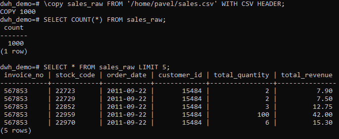
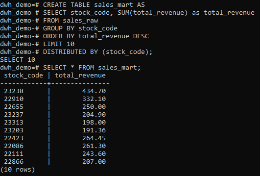

# Greenplum DWH Demo

Pet-проект по развертыванию и работе с MPP-СУБД **Greenplum** в Docker. 
Демонстрирует загрузку данных из CSV, построение аналитических запросов и создание витрин.

## 🛠 Стек технологий

- **Greenplum 6.27.1** (MPP-СУБД, развернута в Docker).
- **PostgreSQL** (клиент `psql` для подключения).
- **CSV** (выгрузка реальных данных из основного DWH-проекта `marketplace-dwh-analytics`).

## 🚀 Что сделано

1.  **Развернут Greenplum в Docker.** Использован образ `woblerr/greenplum:6.27.1`.
2.  **Проверена MPP-архитектура.** Убедились, что работает 1 Master и 2 Segment.
3.  **Загружены реальные данные.** Выгружено 1000 строк из `fct_sales` (основной проект) в таблицу `sales_raw` с распределением по `stock_code` (`DISTRIBUTED BY`).
4.  **Построена витрина.** Создана таблица `sales_mart` (топ-10 товаров по выручке) через `CREATE TABLE AS ... DISTRIBUTED BY`.

## 📸 Скриншоты


*Загрузка 1000 строк в таблицу sales_raw.*


*Создание и проверка витрины sales_mart (топ-10 товаров).*

## 📂 Как запустить

```bash
# Запуск контейнера
docker run -d --name greenplum-db -p 5433:5432 -e GREENPLUM_PASSWORD=gpadmin woblerr/greenplum:6.27.1

# Подключение
psql -h 127.0.0.1 -p 5433 -U gpadmin -d postgres

## 🔗 Связанные проекты

- [marketplace-dwh-analytics](https://github.com/nconichtchenko-arch/marketplace-dwh-analytics) — основной DWH-проект, откуда взяты данные.
